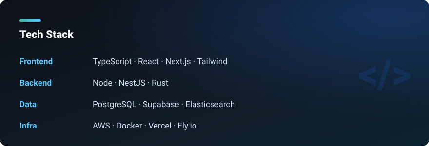

<p align="center">
  
</p>

# Hi 👋, I'm Ray (MyungJin Ko)

### Software engineer who builds and operates what I ship

I co-founded a startup and spent 5 years as its founding engineer — taking a B2B multi-tenant SaaS from **zero to 10+ business customers**, absorbing event-day peaks of **~25K concurrent users with zero downtime**, and operating everything I shipped, from the UI down to the infrastructure and the on-call that follows.

- 🌱 Going deeper on **system design & architecture that stays simple and reliable as it scales**
- 🚀 Looking to help build **ambitious global products where the engineering bar is high** — developer tools, AI, or deep tech — and own problems from zero to one
- 🛠 Polyglot by choice: shipped production systems in **TypeScript, Rust, Java, and C#** — the problem picks the tool
- 📫 Reach me at **rayleighko2@gmail.com** · [linkedin.com/in/rayleighko](https://linkedin.com/in/rayleighko)
- 📄 Résumé — **[English (PDF)](https://github.com/rayleighko/rayleighko/raw/main/resume.pdf)** · **[국문 (PDF)](https://github.com/rayleighko/rayleighko/raw/main/resume_ko.pdf)**
- ⚡ Fun fact — I built and ran a company for 7 years before returning to full-time engineering, and I'm a devoted cat person 🐈

```typescript
const ray = {
  name: "MyungJin Ko (Ray)",
  role: "Software Engineer",
  edge: "builds and operates what I ship — adapts to any stack",
  exFounder: true,            // 7 years, took products 0 → 1
  nowBuilding: "cohort.co.kr",
  nowChasing: "system design × scale",
  catPerson: true,            // 🐈
  motto: "If things are not failing, you are not innovating enough.",
};
```

## 🛠 Tech stack

<p align="center">
  
</p>

## Connect

[](https://github.com/rayleighko)
[](https://linkedin.com/in/rayleighko)
[](https://medium.com/@ray-k)
[](https://leetcode.com/rayleighko)
